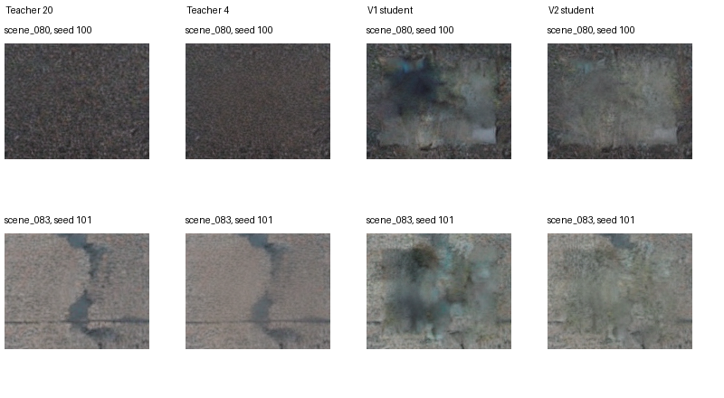
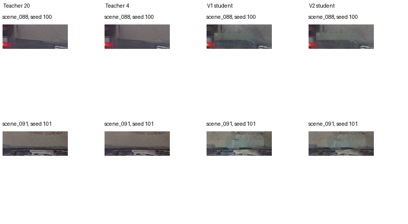

# V1 vs V2 Research Comparison

Completed experiments; final audit dated 20 October 2026.

## 1. Research Background and Objective

The DBALD lane-detection backdoor literature supplies the security context. Our independent hypothesis is: can a task-specific distilled diffusion student significantly reduce generation time and computational cost while maintaining acceptable road-scene realism and relevant lane characteristics?

Efficient generation could make controlled research datasets and repeated evaluation more affordable on an 8 GB laptop GPU. Speed is useful only if outputs retain the properties needed by the task. These experiments implement benign offline road restoration, not poisoning, stealth optimization or targeted lane manipulation. The teacher is a local SD1.5 inpainting proxy, not DBALD UltraEdit. No unpublished thesis text or Chapter 3 implementation is included.

The broad teacher-student hypothesis must be distinguished from this particular compact regression implementation. Published DBALD clean/poisoned ACC and attack-specific ASR remain reference values; none is inferred from the following image or detector metrics.

## 2. Existing Research Foundation

LaneATT, ADNet, SCNN and RESA adapters, public pretrained checkpoints, preprocessing checks and official dataset scorers underpin the project. These are detector evaluations, not training of our diffusion student.

| Detector | Backbone | Images | Clean TuSimple ACC % |
| --- | --- | --- | --- |
| ADNet | resnet18 | 2782 | 96.234349 |
| RESA | resnet18 | 2782 | 96.695915 |
| SCNN | resnet18 | 2782 | 96.084256 |
| ADNet | resnet34 | 2782 | 96.598242 |
| RESA | resnet34 | 2782 | 96.818942 |
| LaneATT | resnet34 | 2782 | 95.634778 |
| LaneATT | resnet18 | 2782 | 95.571018 |

LaneATT restores the original PyTorch 1.6 anchor ordering; older ordering-affected results remain explicitly superseded. Original-version CPU reference environments are separate from the RTX 5050 CUDA-compatible environment. RESA and ADNet passed their 16-image legacy-CPU versus modern-CUDA checks, within the documented implementation substitutions.

SCNN cross-version equivalence remains unresolved: identical preprocessing and close backbone features diverge after aggregation. Its current-runtime measurements are not proof of original-version reproduction. CULane uses the official C++ lane-IoU/F1 evaluator with OpenCV 4.13 in place of 2.4; rasterization equivalence is not established. SCNN CULane uses the available R50 checkpoint, not the paper-required R34.

## 3. V1: Initial Distillation Experiment

A conditional U-Net with 2,381,044 parameters predicts equivalent epsilon targets for four coarse deterministic DDIM transitions. The frozen teacher denoiser has 859,535,364 parameters; the shared VAE/safety components have 387,635,451. Four coarse times are 951, 701, 451 and 201. The teacher uses 20 steps; the student and undistilled control use the matched four-transition schedule.

Training: 64 TuSimple scenes, one noise seed (0), batch 8, AdamW learning rate 0.0002, 2,000 updates, global equivalent-epsilon MSE, gradient clipping 1. Validation: 16 separate TuSimple clips. Final benchmark: eight TuSimple and eight available CULane scenes, seeds 100/101. The student is FP32; frozen teacher/VAE inference is FP16.

Teacher preparation: 80 trajectories, 269.527688 seconds of encoding/denoising, excluding loading, cooling and writes. Student training: 155.324961 seconds including cooling, peak 1198.337 MiB.

Selection used validation rollout latent MSE, choosing update 1700. MSE improved from 0.6552920900 to 0.0142409245. This did not guarantee decoded quality: final student patches showed conspicuous discoloration and blotches. V1 did not predeclare V2-style numerical quality thresholds; its quality-preservation objective failed by observed artifacts and poor teacher fidelity.

V1 measured substantial speed and allocation reductions, but did not demonstrate acceptable realism, learned lane preservation, full-dataset diffusion generalization or backdoor effectiveness.

## 4. V2: Improved Distillation Experiment

V1 diagnostics showed a noise-generalization gap and accumulated rollout error. TuSimple validation MAE increased from 15.71 at seed 0 to 30.55 at unseen seed 17. Final edited-region teacher-forced MSE was 0.0270/0.0466 versus rollout 0.0773/0.2065. The dilated edit occupies only 7.81% of TuSimple and 2.27% of CULane latents, motivating a loss-weighting test.

| Candidate | Loss | Cached examples | Additional updates |
| --- | --- | --- | --- |
| control_global | Global epsilon MSE | 64 | 1000 |
| mask_single | 0.5 global + 0.5 regional MSE | 64 | 1000 |
| mask_diverse | Same regional loss; extra noise | 128 | 1000 |

All runs start from the identical V1 selected checkpoint, use the same architecture, 64 images, optimizer and batch size. The diverse run adds one unique teacher seed per training scene, seeds 2000-2063. Validation uses eight TuSimple and four CULane scenes at seeds 0/17; files are disjoint from final evaluation. Six checkpoints (500/1000 per candidate) were considered.

Selection uses decoded local LPIPS with boundary error no worse than V1 on either dataset and MAE as tie-break. The selected diverse checkpoint at update 1000 was hash-locked before final evaluation. The original V1 test set is reused and previously observed; it is not a new pristine test set.

At 1000 updates, pooled validation LPIPS was 0.2709 for continuation, 0.2833 for regional loss alone and 0.1952 for regional loss plus diversity (V1 0.2629). Regional weighting alone was not a successful fix. Diversity improved this run against both controls; no global-loss-plus-diversity arm isolated the interaction.

| Scope | Criterion | Measured | Threshold | Passed |
| --- | --- | --- | --- | --- |
| TuSimple | SSIM | 0.7531 | 0.85 | False |
| TuSimple | MAE | 14.8836 | 6.604214986165365 | False |
| TuSimple | LPIPS | 0.1737 | 0.09726107985945419 | False |
| TuSimple | Boundary | 8.1386 | 4.7842726934523805 | False |
| CULane | SSIM | 0.6118 | 0.85 | False |
| CULane | MAE | 15.7496 | 5.374226888020833 | False |
| CULane | LPIPS | 0.2382 | 0.05317978931590915 | False |
| CULane | Boundary | 14.1194 | 4.574484223300971 | False |
| TuSimple | Clean metric drop pp | 0.0372 | 0.5 | True |
| TuSimple | Lane displacement px | 0.0856 | 1.0 | True |
| TuSimple | Lane coverage | 0.9994 | 0.99 | True |
| CULane | Clean metric drop pp | 0.0000 | 2.0 | True |
| CULane | Lane displacement px | 0.5873 | 1.0 | True |
| CULane | Lane coverage | 0.9945 | 0.99 | True |
| Timing sample | Latency seconds | 0.3261 | 0.6 | True |
| Timing sample | Speedup | 11.0382 | 3.0 | True |
| Timing sample | Peak MiB | 1373.4204 | 7168 | True |
| TuSimple | Visual acceptable fraction | 0.0000 | 0.9 | False |
| CULane | Visual acceptable fraction | 0.0000 | 0.9 | False |

All eight dataset-specific quantitative quality checks failed. The visual review found conspicuous artifacts in all 24 selected-student validation cases under the strict criterion. All six final lane-subset checks and three speed/allocation checks passed. These outcomes are not interchangeable.

## 5. Direct V1 vs V2 Comparison

### TuSimple: eight scenes, two seeds, 16 cases per method

| Method | Masked MAE | Masked SSIM | Local LPIPS | Boundary residual |
| --- | --- | --- | --- | --- |
| student_v1 | 20.407120 | 0.639570 | 0.376990 | 13.265858 |
| student_v2 | 13.696615 | 0.756519 | 0.202801 | 9.008603 |
| teacher20 | 0.000000 | 1.000000 | 0.000000 | 0.000000 |
| teacher4 | 2.701380 | 0.909400 | 0.061488 | 2.461542 |

Perceptual-error reduction = 100 x (0.3769903891 - 0.2028006995) / 0.3769903891 = 46.2053%.

| Method | ACC % | Displacement px | Coverage |
| --- | --- | --- | --- |
| clean | 97.228423 | 0.000000 | 1.000000 |
| teacher20 | 97.228423 | 0.061383 | 1.000000 |
| teacher4 | 97.256324 | 0.100840 | 1.000000 |
| student4 | 97.116815 | 0.128517 | 0.997247 |
| student_v2 | 97.191220 | 0.085612 | 0.999432 |

### CULane: eight scenes, two seeds, 16 cases per method

| Method | Masked MAE | Masked SSIM | Local LPIPS | Boundary residual |
| --- | --- | --- | --- | --- |
| student_v1 | 17.186482 | 0.606158 | 0.248263 | 15.232422 |
| student_v2 | 14.212838 | 0.619899 | 0.220055 | 11.377232 |
| teacher20 | 0.000000 | 1.000000 | 0.000000 | 0.000000 |
| teacher4 | 2.300384 | 0.935960 | 0.029020 | 2.231585 |

Perceptual-error reduction = 100 x (0.2482633870 - 0.2200547336) / 0.2482633870 = 11.3624%.

| Method | Lane F1 % | Displacement px | Coverage |
| --- | --- | --- | --- |
| clean | 66.666667 | 0.000000 | 1.000000 |
| teacher20 | 67.424242 | 0.140146 | 0.974910 |
| teacher4 | 68.217054 | 0.419866 | 0.950382 |
| student4 | 66.666667 | 0.660780 | 0.995992 |
| student_v2 | 66.666667 | 0.587341 | 0.994516 |

LPIPS uses the SqueezeNet v0.1 learned perceptual metric on the raw edit bounding box plus eight pixels of context, resized to 128 x 128. Lower is better; this is similarity to teacher20, not a realism probability. V1 images were rescored with the same V2 metric; V1 did not originally measure LPIPS. MAE is on a 0-255 scale; SSIM is higher-is-better. Boundary residual compares across-mask-edge RGB differences with the teacher composite.

The examples show weaker dark blotches in V2 but persistent rectangular discoloration. They are representative paired examples, not a blinded realism study. Raw generated patches are shown to avoid copied background inflating quality.

### Common contemporaneous timing protocol

| Method | Steps | Median seconds | Peak allocated MiB |
| --- | --- | --- | --- |
| teacher20 | 20 | 3.600086 | 3256.270 |
| teacher4 | 4 | 0.965800 | 3256.270 |
| student_v1 | 4 | 0.322838 | 1373.420 |
| mask_diverse | 4 | 0.326149 | 1373.420 |

Four fixed validation scenes, two per dataset; seed 17; two repetitions per scene and one warmup per method. Includes encode, noise, denoise, decode, safety check and composite; excludes loading, disk I/O and cooling. V2 student is mask_diverse. V1 student is retimed under this common protocol. Do not attribute the small V1/V2 timing difference to a significant regression; the architecture is unchanged and there are no independent run replications.

### Original V1 timing protocol, reported separately

| Dataset | Method | Median seconds | Peak MiB |
| --- | --- | --- | --- |
| TuSimple | teacher20 | 3.481243 | 3256.270 |
| TuSimple | teacher4 | 0.900655 | 3256.270 |
| TuSimple | student4 | 0.309644 | 1373.420 |
| CULane | teacher20 | 3.480877 | 3256.270 |
| CULane | teacher4 | 0.895922 | 3256.270 |
| CULane | student4 | 0.304495 | 1373.420 |

V1 used eight scenes per dataset, two seeds and two timing repetitions; aggregation is the median of per-scene/seed medians. Its approximately 11.2x headline is a rounded TuSimple value; CULane is about 11.43x. These original timings are not directly pooled with the V2 timing sample.

### Preparation and training costs

| Run | Seconds | Peak MiB | Time scope |
| --- | --- | --- | --- |
| V1 cache | 269.528 | 3034.0 | Encode/trajectory only |
| V1 training | 155.325 | 1198.3 | Training + cooling |
| V2 control_global | 117.542 | 1943.7 | Training + validation + cooling |
| V2 mask_single | 117.163 | 1943.7 | Training + validation + cooling |
| V2 mask_diverse | 134.104 | 1982.7 | Training + validation + cooling |
| V2 extra 64 trajectories | 211.039 | Not recorded separately | Encode/trajectory only |

V2 validation-reference preparation cost was not completely separately timed. End-to-end research preparation cost, FLOPs, energy and sustained throughput were not measured. Training time scopes differ, so the tables do not claim V2 training is cheaper than V1. Student inference peak allocation decreases from 3256.270 to 1373.420 MiB, approximately 57.82%; whole-device VRAM is a different quantity. Shared components remain substantial.

## 6. Dataset Coverage and Limitations

Full TuSimple clean detector evaluations contain 2,782 official test images. They are distinct from the eight-scene-per-dataset diffusion benchmark. CULane diffusion and detector subsets are incomplete; the available test material is concentrated in driver_37. No full CULane evaluation or cross-drive generalization claim is established.

The CULane mask is a narrow 1,536-pixel strip above the vehicle hood; TuSimple uses up to 12,288 pixels. Training uses TuSimple scenes and its larger mask geometry. Dataset shift and mask-shape shift are not isolated. CULane validation/test file disjointness does not establish drive-level independence.

Lane consistency is conditional on detected clean points: TuSimple has 16 defined scene/seed cases; CULane has 14 of 16 because one clean scene has no reference points. Undefined values are omitted, not set to zero; official dataset scores still include all eight scenes. Raw lane-band MAE is also defined for only 14 CULane cases.

Ground-truth lane bands are protected and outside-mask pixels are copied exactly. This oracle compositing is not learned preservation. CULane F1 is averaged over two separately scored seed runs and is not DBALD point ACC. SCNN cross-version aggregation divergence remains unresolved. One training run per candidate, small subsets and reused test images limit inference.

## 7. Research Hypothesis Assessment

| Claim | Assessment | Evidence |
| --- | --- | --- |
| A. Generation latency | Supported | About 11.04x faster than teacher20 under the common laptop protocol; 0.326149 s vs 3.600086 s. |
| B. Computational/memory requirements | Partially supported | Four rather than 20 steps and 57.82% lower peak inference allocation; FLOPs, energy and total lifecycle cost unmeasured. |
| C. Teacher approximation | Partially supported | Paired fidelity improves over V1, especially TuSimple, but remains far worse than the undistilled four-step teacher. |
| D. Acceptable image quality | Contradicted by current evidence | All predeclared quantitative image-quality checks and visual acceptance fail. |
| E. Independently learned lane preservation | Not demonstrated | Composite lane-subset checks pass, but annotation-based protection copies the lane pixels. |
| F. Generalization across datasets | Partially supported | Some fidelity improvements on both small subsets; full-dataset and independent-drive generalization are not demonstrated. |
| G. Backdoor-security effectiveness | Not demonstrated | No poisoning, attack-specific ASR or defense-efficacy experiment was run. |

The combined hypothesis is not achieved: efficiency success does not cancel the quality failure. Published poisoned-model ACC and ASR remain reference-only and cannot be replaced with clean detector accuracy or image similarity.

## 8. Is the Proposed Methodology Worth Continuing?

Recommendation: continue the broad task-specific teacher-student diffusion methodology, but revise specific technical components in a bounded, separately authorized study. Do not continue the unchanged V1/V2 recipe or merely extend its updates.

This recommendation rests on measured evidence, not sunk cost: the student delivers a large practical speed/allocation advantage, and a controlled noise-diversity intervention improves fidelity at the same architecture and update budget. However, the undistilled four-step teacher already reaches much better quality at roughly 0.966 seconds. It is an essential practical comparator; the student must justify its extra compression against that quality-cost frontier, not only against a 20-step teacher.

The broad approach is plausible; this particular 2.38-million-parameter global/regional regression implementation is not yet sufficient. A conditional next iteration would isolate rollout-aware supervision, decoded perceptual objectives or training-mask diversity one at a time, with matched controls and a new prospective test set. Capacity should be tested rather than assumed to be the cause. These are recommendations only: no V3, training or new methodology was executed in this finalization task.

Risks include insufficient capacity, accumulation of teacher-forcing errors, weak scene/noise coverage, oracle mask dependence, dataset/geometry shift and overfitting a small validation set. Quality thresholds must remain fixed before evaluation; independent visual assessment and clean lane measurements without oracle copying are needed for broader claims.

Resources: the current inference and selected training allocations fit the 8 GB GPU, but larger models and decoded training objectives are not benchmarked and may require memory-saving techniques or more hardware. More representative licensed data, complete CULane access, fresh test drives and independent human review are more important than an unbounded update budget. No credible cost estimate for those untested extensions is available.

Decision gate: fund only a small predeclared comparison that must materially close the quality gap to teacher4 while retaining a useful speed advantage. If repeated controlled revisions cannot do so, reconsider the aggressive compact architecture or the operational need for this compression. The existing evidence justifies investigation, not a promise of eventual success.

## 9. Final Research Status

Established within the measured scope: a functioning local pipeline, substantial generation speedup and lower peak inference allocation. Improved: teacher fidelity and some visible artifacts relative to V1. Unproven: acceptable realism, independently learned lane preservation, full-dataset generalization, security effectiveness and total lifecycle efficiency.

The complete research objective has not been achieved. The work is suitable as an initial research prototype and a documented negative/partial result. It supports a carefully limited future iteration of the broad methodology, not deployment or an assertion that the present implementation preserves quality.

The finalization audit reads existing checkpoints, logs, images and metrics without model execution. All 394 preserved V1 files match their recorded hashes; V2 selection/checkpoint and result cardinalities match the saved records. Previously executed tests report 26 passing in V1 and 29 in V2. No tests requiring model generation or new training were rerun.

Publication provenance: the local V1/V2 commits include a confidential Chapter 2 extract in their ancestry. Sanitized publication snapshots must omit it, preserve the original local history and identify their source commits. Research code is retained; publication tags must be labelled as sanitized snapshots rather than pretending to be the original local commit IDs. Downloaded datasets, weights, environments and unpublished thesis sources are excluded.

## 10. Supervisor Executive Summary

The project tested whether a compact task-specific diffusion student could make road-scene generation substantially cheaper while preserving visual quality and lane characteristics. The teacher-student approach was retained throughout V1 and V2; no operational backdoor attack was implemented.

Efficiency succeeded within the laptop experiment. Under a common protocol, the selected student required 0.326 seconds per image versus 3.600 seconds for the 20-step teacher, about 11x faster. Peak allocated inference memory fell by approximately 58%. These are measured inference benefits, not measurements of energy or full research cost.

Quality improved but remains inadequate. Relative to V1, V2 reduced local perceptual error against the teacher by approximately 46% on the eight-scene TuSimple benchmark and 11% on the eight-scene CULane subset. Dark blotches became weaker, but discolored rectangular patches remained. All declared image-quality acceptance criteria failed; the undistilled four-step teacher still gives much better fidelity.

Final lane-consistency subset thresholds passed. This cannot establish independently learned lane preservation because annotated lane pixels and the background were protected by compositing. Full TuSimple clean detector results are separate evidence; full CULane and SCNN cross-version equivalence remain incomplete. No attack success rate or defense effectiveness was measured.

Recommendation: retain the broad research direction but revise the implementation in a bounded future study with controlled technical changes, fresh evaluation data and explicit stopping criteria. The measured speed benefit and response to noise diversity justify further investigation. They do not establish that the complete hypothesis is true or that the current model is suitable for deployment. V1 and V2 are complete; no V3 was started.

Primary methodological context: [Progressive distillation](https://arxiv.org/abs/2202.00512), [guided diffusion distillation](https://arxiv.org/abs/2210.03142), [LPIPS](https://arxiv.org/abs/1801.03924), [DBALD](https://arxiv.org/html/2508.15778v2). Local evidence: results/distillation/v1/{training.json,generation_summary.csv,evaluation.json,lane_consistency.json}; results/distillation/v2/{selection.json,final_quality.json,timing_summary.csv,lane_summary.csv,acceptance.csv}; results/measured_results.csv. Detailed protocols and original reports remain alongside this comparison.
