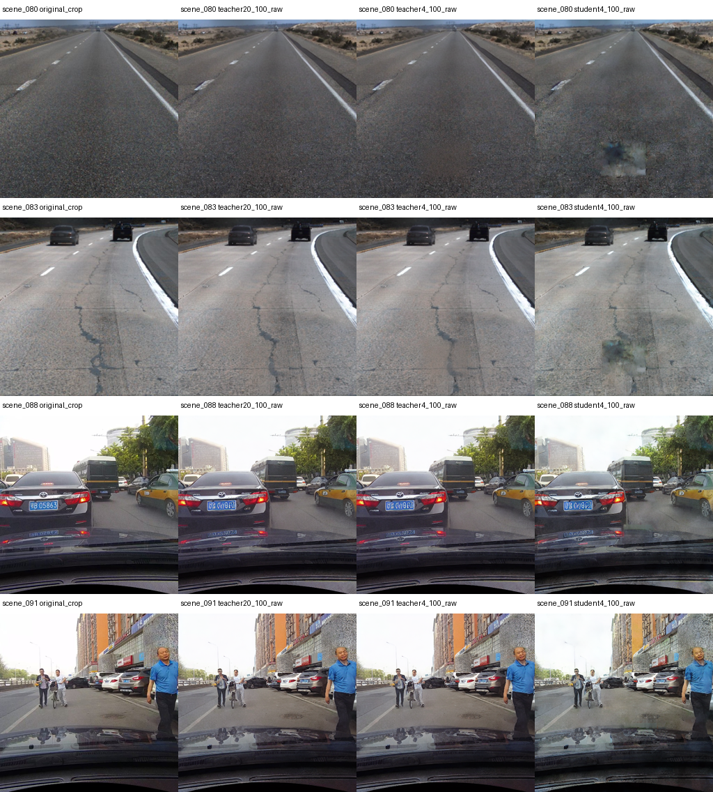
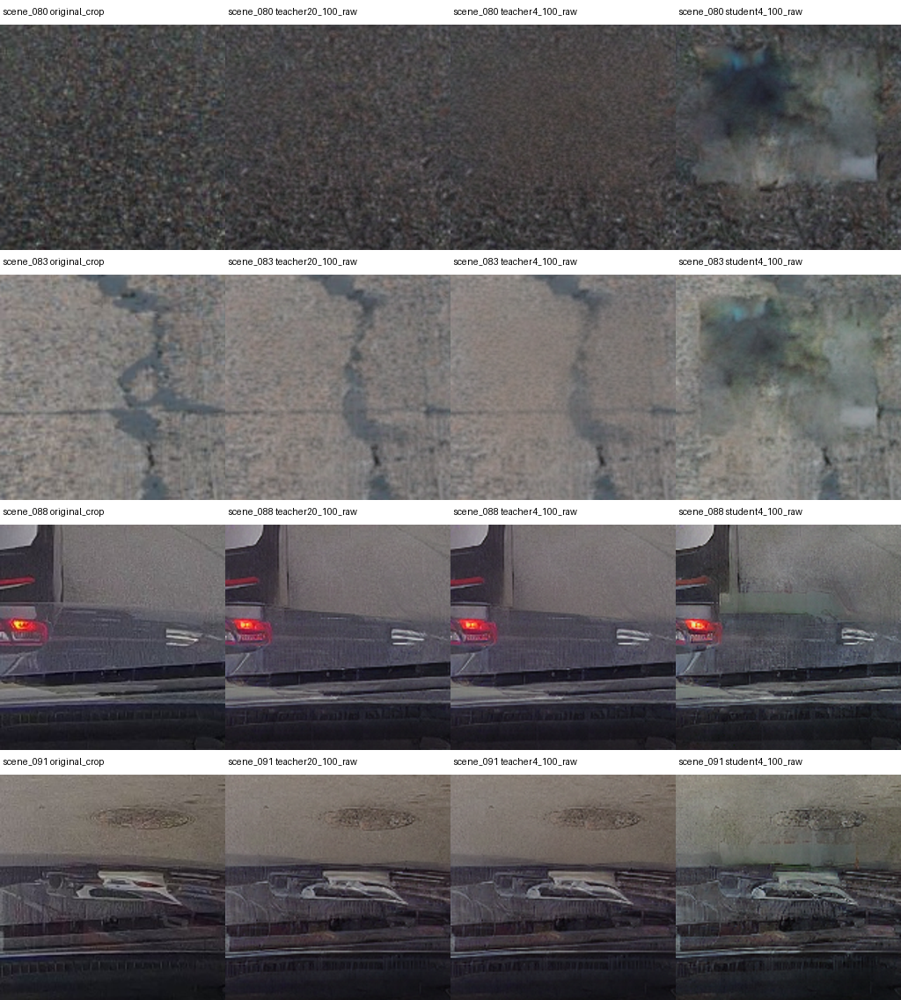
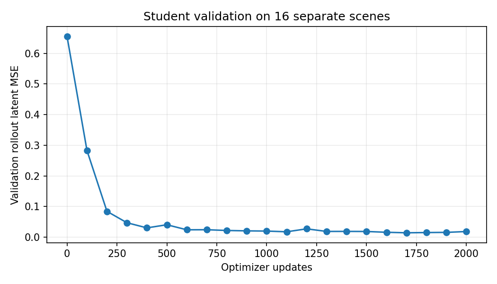

# Task-specific road diffusion distillation: research report

**Finding:** the compact student fits the 8 GB GPU and is substantially faster, but this first prototype does not meet the quality-preservation objective. Its masked teacher agreement is worse than the undistilled four-step control, and inspected TuSimple outputs contain conspicuous blotchy edits. This is a measured feasibility result with a quality failure, not a successful DBALD reproduction or evidence that attack effectiveness is preserved.

## Scientific question and scope

The thesis Chapter 2 motivates an efficient task-specific generator in the context of naturalistic backdoor data poisoning. This experiment measures a bounded component: whether a compact student can approximate ordinary road-restoration outputs from a general-purpose diffusion teacher with fewer steps and lower computational cost. It does not implement poisoning or test attack effectiveness. DBALD remains the security reference, with published ACC/ASR kept separate from local clean-model and editing measurements. No Chapter 3 was requested or used.

## Independent method

A frozen SD1.5 inpainting teacher (a proxy, not DBALD UltraEdit) supplies 20-step deterministic DDIM trajectories. A compact conditional U-Net learns four coarse transitions from cached teacher states. This is offline trajectory regression inspired by distillation, not an exact LCM or progressive-distillation reproduction. The student has a fixed restoration task, no open-ended text conditioning, and shares the frozen teacher VAE and safety checker.

Training uses 64 TuSimple train clips, validation 16 separate clips, and evaluation eight held-out TuSimple plus eight available CULane scenes. Training/validation clips were checked against all official TuSimple test clips. File-hash ordering fixed selection before generation. One training noise seed and two different evaluation seeds make this a small feasibility study. All methods use identical 512-pixel crops, masks, conditions and initial noise. Annotation-based lane protection is an oracle aid and is not demonstrated deployable segmentation.

The student has 2,381,044 parameters; the teacher denoiser has 859,535,364. Shared VAE/safety-checker parameters: 387,635,451. There were 2,000 optimizer updates, taking 155.32 seconds including training cooling breaks; peak PyTorch training allocation was 1198.3 MiB. Validation rollout latent MSE changed from 0.655292 to a best 0.014241; the selected checkpoint is update 1700. Selection never used held-out image quality or detector outcomes. Teacher/VAE inference uses FP16; the compact student uses FP32.

Preparing the 80 cached teacher trajectories used 269.53 seconds of measured encoding/denoising, excluding loading, cooling and file writes. This is an additional preparation cost, not part of student inference latency; one cached trajectory predates the user pause and is not used as a held-out timing sample.

## Measured generation results

Each table contains eight scenes × two seeds per method. Latency is the median of per-scene/seed medians (two timed repetitions after warm-up). Timing includes image encoding, denoising, VAE decoding, safety checking and native-frame compositing, but excludes model loading, cached prompt encoding, disk writes and cooling breaks. Values describe this thermally constrained laptop, not sustained-throughput performance. Peak allocated memory is live PyTorch GPU allocation, not total system VRAM.

Masked SSIM/MAE quantify agreement with the 20-step teacher only. They are not realism scores. Raw lane-band MAE is measured before compositing, on a 0–255 scale. Outside-mask identity in the final composite is guaranteed by copying source pixels and cannot prove learned preservation. TuSimple masks cover up to 12,288 pixels; CULane uses a 1,536-pixel road strip above its visible hood, fixed during input QA before evaluation. Different edit areas limit cross-dataset comparisons.

### TuSimple editing subset

| Method | Steps | Median seconds | Peak MiB | Masked teacher SSIM | Masked teacher MAE | Raw lane MAE |
| --- | --- | --- | --- | --- | --- | --- |
| teacher20 | 20 | 3.4812 | 3256.3 | 1.0000 | 0.00 | 6.84 |
| teacher4 | 4 | 0.9007 | 3256.3 | 0.9094 | 2.70 | 6.86 |
| student4 | 4 | 0.3096 | 1373.4 | 0.6396 | 20.41 | 8.57 |

| Method | Subset ACC % | Prediction MAE vs clean (px) | Clean-point coverage | ASR |
| --- | --- | --- | --- | --- |
| clean | 97.2284 | 0.000 | 1.0000 | unmeasured |
| teacher20 | 97.2284 | 0.061 | 1.0000 | unmeasured |
| teacher4 | 97.2563 | 0.101 | 1.0000 | unmeasured |
| student4 | 97.1168 | 0.129 | 0.9972 | unmeasured |

Frozen LaneATT-R34 assessment. Conditional MAE must be read with coverage; these benign edits were not optimized against the detector. TuSimple scoring uses zero runtime to isolate geometry; this is not a new timed full benchmark.

### CULane editing subset

| Method | Steps | Median seconds | Peak MiB | Masked teacher SSIM | Masked teacher MAE | Raw lane MAE |
| --- | --- | --- | --- | --- | --- | --- |
| teacher20 | 20 | 3.4809 | 3256.3 | 1.0000 | 0.00 | 9.09 |
| teacher4 | 4 | 0.8959 | 3256.3 | 0.9360 | 2.30 | 9.08 |
| student4 | 4 | 0.3045 | 1373.4 | 0.6062 | 17.19 | 12.65 |

| Method | Subset lane F1 % (mean over seeds) | Prediction MAE vs clean (px) | Clean-point coverage | ASR |
| --- | --- | --- | --- | --- |
| clean | 66.6667 | 0.000 | 1.0000 | unmeasured |
| teacher20 | 67.4242 | 0.140 | 0.9749 | unmeasured |
| teacher4 | 68.2171 | 0.420 | 0.9504 | unmeasured |
| student4 | 66.6667 | 0.661 | 0.9960 | unmeasured |

Frozen LaneATT-R34 assessment. Conditional MAE must be read with coverage; these benign edits were not optimized against the detector. TuSimple scoring uses zero runtime to isolate geometry; this is not a new timed full benchmark.

## Visual evidence

The four gallery scenes were fixed in the report script before outputs were inspected. These are uncomposited model outputs, not blinded human ratings. Qualitative inspection found blotchy student edits in scenes 080 and 083. Scene 088 also shows that raw teacher and student outputs can alter vehicle placement outside the intended mask. Final compositing prevents those outside-mask alterations, but this is an imposed constraint, not learned scene preservation. No numerical realism rating was collected.

## Existing clean benchmarks and published security references

Previously completed full baselines are reused. No incomplete CULane run is represented as a full evaluation.

### TuSimple

| Model | Backbone | Images | Local clean metric | Value % |
| --- | --- | --- | --- | --- |
| ADNet | resnet18 | 2782 | ACC | 96.2343 |
| RESA | resnet18 | 2782 | ACC | 96.6959 |
| SCNN | resnet18 | 2782 | ACC | 96.0843 |
| ADNet | resnet34 | 2782 | ACC | 96.5982 |
| RESA | resnet34 | 2782 | ACC | 96.8189 |
| LaneATT | resnet34 | 2782 | ACC | 95.6348 |
| LaneATT | resnet18 | 2782 | ACC | 95.5710 |

Published DBALD reference only (all architectures ResNet-34 in the extended Appendix C):

| Model | Published benign ACC | Published poisoned ACC | Published LDA ASR | Published LRA ASR | Published LOA ASR |
| --- | --- | --- | --- | --- | --- |
| LaneATT | 96.81 | 95.72 | 90.04 | not reported | 91.63 |
| ADNet | 96.87 | 96.61 | 89.24 | not reported | 72.07 |
| SCNN | 93.78 | 92.28 | 95.78 | not reported | 91.29 |
| RESA | 96.81 | 96.67 | 96.57 | not reported | 94.28 |

### CULane

| Model | Backbone | Images | Local clean metric | Value % |
| --- | --- | --- | --- | --- |
| ADNet | resnet18 | 16 | lane F1 | 60.7595 |
| ADNet | resnet34 | 16 | lane F1 | 67.5000 |
| RESA | resnet34 | 16 | lane F1 | 53.4884 |
| SCNN | resnet50 | 16 | lane F1 | 56.1798 |
| LaneATT | resnet34 | 16 | lane F1 | 61.5385 |

Published DBALD reference only (all architectures ResNet-34 in the extended Appendix C):

| Model | Published benign ACC | Published poisoned ACC | Published LDA ASR | Published LRA ASR | Published LOA ASR |
| --- | --- | --- | --- | --- | --- |
| LaneATT | 75.01 | 74.20 | 81.65 | 73.45 | 74.19 |
| ADNet | 85.51 | 82.37 | 66.49 | 64.82 | 68.17 |
| SCNN | 69.75 | 68.75 | 76.19 | 67.34 | 68.69 |
| RESA | 78.98 | 77.39 | 78.15 | 65.15 | 76.86 |

## Contribution and next controlled experiment

This work contributes an executable local teacher/student measurement protocol and a negative quality result: a 2.38-million-parameter student reduces latency and allocation, but does not preserve teacher editing quality. The undistilled four-step control currently offers much closer teacher fidelity. Stable final lane scores alone would conceal the student's visible artifacts.

Two plausible explanations require experiments, not assertions: full-crop latent loss gives little weight to the small edited region, and training/validation use one noise seed while held-out evaluation uses new seeds. A next study should predeclare mask-weighted fidelity and multi-seed validation, compare against a pretrained latent-consistency adapter, and reserve a new untouched test set. The present held-out scenes must not become an iterative tuning target. Additional training is not claimed to have solved these issues.

The original-version audit also found a separate unresolved SCNN discrepancy after aggregation, despite identical inputs and close backbone features. RESA and ADNet passed the 16-image old-CPU versus modern-CUDA checks. See the package compatibility report; no full baseline has been silently replaced.

## Limitations and remaining research questions

- Neither a low fidelity error nor a plausible composite proves naturalistic trigger stealth or backdoor success. All local ASR values remain unmeasured.
- Human realism ratings have not been collected. The comparison gallery is for qualitative inspection; no FID or validated realism score is claimed from 16 scenes.
- CULane evaluation scenes come only from the available driver_37 subset. Full CULane remains blocked by incomplete official archives/download quotas. CULane lane F1 is not the paper's point ACC.
- The small training set and single training seed limit generalization. Latent teacher-forcing loss and rollout image quality can disagree; uncomposited outputs must be inspected.
- A shared VAE and safety checker impose fixed runtime/memory costs. Four teacher calls still use classifier-free guidance with two effective batch elements per call; the student uses one.
- Older detector package versions are preserved in separate CPU reference environments. The RTX 5050 execution environment uses a newer compatible CUDA stack; this is not exact DBALD environment equivalence.
- The paper's exact poisoned checkpoints, target scoring bundle and training indices remain unavailable. No operational backdoor or defense-efficacy experiment was executed.

## Reproduction and evidence

Verification: 26 tests passed. The output audit verified all 96 original source hashes, all 96 generated/composited cases, exact outside-mask and annotated-lane pixel copying, and checkpoint selection against validation history. Independently recalculated masked MAE differs by 0.0. This verifies implementation bookkeeping; it does not override the observed quality failure.

Run `scripts/distill_road.py cache`, then `train`, then `evaluate` in the documented CUDA environment, followed by `scripts/evaluate_edit_lanes.py` and this report builder. The cache and training checkpoints resume locally. `config.json`, dataset manifest, training history, evaluation JSON, lane predictions and source hashes accompany this report. All code and research artifacts remain local.

See [methodology](distillation_methodology.md), [security evaluation boundaries](security_evaluation_boundary.md), and [package compatibility](package_compatibility.md). Primary methodology references: [progressive distillation](https://arxiv.org/abs/2202.00512), [LCM](https://arxiv.org/abs/2310.04378), [official Diffusers training documentation](https://huggingface.co/docs/diffusers/training/lcm_distill). Security reference: [DBALD author paper](https://arxiv.org/html/2508.15778v2).