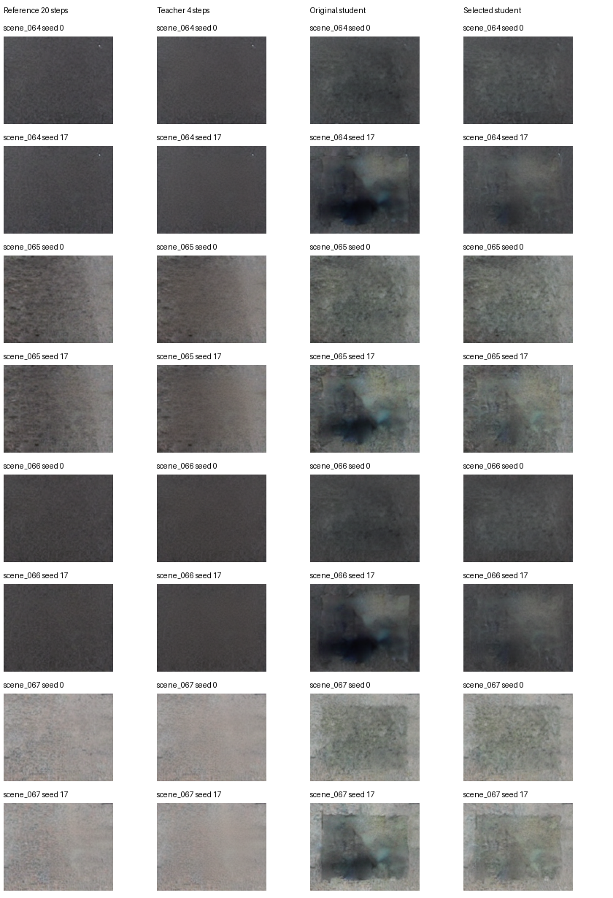
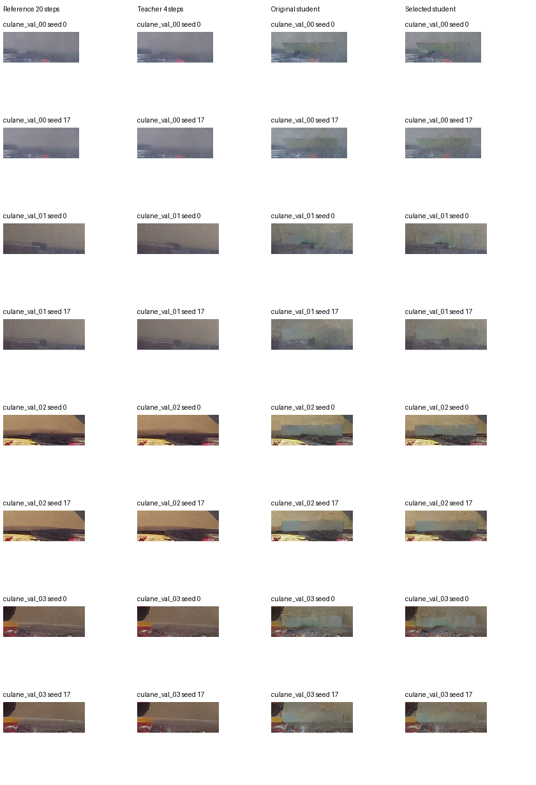
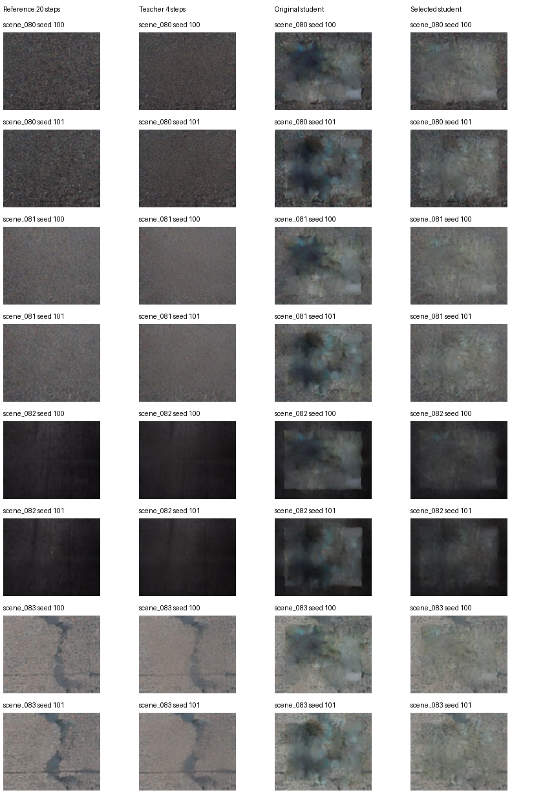

# Task-specific road diffusion distillation: experiment v2

**Overall predeclared acceptance: NOT MET.** This report continues the original teacher–student experiment. All v1 artifacts are preserved. It tests two proposed quality improvements against an equal-update continuation control, then evaluates a validation-selected checkpoint on the reused v1 benchmark. No attack success rate was measured.

## Question and evidence-supported diagnosis

The fixed research question is whether a compact task-specific diffusion student can reduce generation cost while retaining realistic road appearance and lane characteristics. The naturalistic-backdoor literature supplies the security context; implementation remains benign offline restoration. No poisoning, optimized triggers or targeted lane manipulation is implemented.

TuSimple validation MAE rose from 15.71 at the original training noise seed to 30.55 at an unseen seed, and local LPIPS from 0.126 to 0.399. The four-step teacher remained near MAE 3.03–3.11. Student rollout latent errors exceeded teacher-forced transition errors: final edited-region MSE 0.077/0.207 versus 0.027/0.047. These observations support noise-generalization and accumulated approximation error as contributors. CULane remained poor at both seeds, so one explanation does not cover all errors.

The dilated latent edit occupies 7.81% of TuSimple and 2.27% of CULane latents, motivating a regional-loss test. The four-step teacher already has much better decoded fidelity, so reducing the step count alone does not explain the compact student’s failure. Capacity is not isolated in this experiment. Verified pixel compositing does not remove a visibly poor generated patch; latent error is not a guarantee of decoded quality. See [full diagnosis](distillation_v2_diagnosis.md).

## Controlled methodology

All candidates start from the same v1 update-1700 checkpoint and use the same 2,381,044-parameter architecture, four-step schedule, 64 TuSimple training scenes, batch size 8, AdamW learning rate 0.0002, initialization seed and 1,000 additional updates. Checkpoints at updates 500 and 1,000 are assessed on decoded outputs.

| Candidate | Objective | Training trajectories |
| --- | --- | --- |
| control_global | Original global equivalent-epsilon MSE | 64, seed 0 |
| mask_single | 0.5 global + 0.5 dilated-edit-region MSE | 64, seed 0 |
| mask_diverse | Same regional objective | 128: seed 0 plus one unique noise per scene |

Validation uses eight TuSimple scenes and four available CULane scenes, at seeds 0 and 17. The additional training noises are seeds 2000–2063, never validation or test seeds. Training image count is unchanged. CULane validation and evaluation files are disjoint but come from a narrow available source; independent drive-level generalization is not established.

Selection used mean validation local LPIPS, with no worse boundary error than v1 on either dataset and MAE as tie-break. The selected model is **mask_diverse, additional update 1000**, SHA-256 `025378cdd5f5b558c314498d74145d63f96c144f3fe236f1eac92367cda2fb21`. The selection was locked before final test generation. The v1 test set was previously observed, so it is a reused benchmark, not a new pristine test set.

The frozen teacher remains SD1.5 inpainting, a local proxy rather than DBALD’s UltraEdit. Teacher sampling uses 20 deterministic DDIM steps; the coarse teacher and student use the same four transition times. The student shares the frozen VAE and safety checker. Teacher components use FP16 and the student FP32. All versions and compatibility fixes remain unchanged from v1; this is not a claim of exact DBALD software equivalence.

Deterministic trajectory targets are motivated by [progressive distillation](https://arxiv.org/abs/2202.00512) and [guided diffusion distillation](https://arxiv.org/abs/2210.03142). Noise diversity is informed by the [official Diffusers distillation recipe](https://huggingface.co/docs/diffusers/training/lcm_distill). This compact regression method is not claimed to reproduce those algorithms exactly. The regional objective is our controlled task-specific hypothesis. [LPIPS](https://arxiv.org/abs/1801.03924) complements pixel and structural fidelity; it is not a realism probability.

## Validation outcomes and acceptance

MAE uses 0–255 pixels. SSIM is higher-is-better; MAE, local SqueezeNet-LPIPS and boundary residual are lower-is-better. Local LPIPS uses the raw edit bounding box plus eight pixels of context, resized to 128×128. Boundary residual measures across-mask-edge RGB differences relative to the teacher composite. Quality is measured inside raw generated edits rather than diluted by copied background. TuSimple and CULane edit sizes differ and are kept separate.

### TuSimple validation

| Method / update | Cases | MAE | SSIM | Local LPIPS | Boundary |
| --- | --- | --- | --- | --- | --- |
| control_global_1000 | 16 | 20.746 | 0.6817 | 0.2629 | 11.055 |
| control_global_500 | 16 | 21.513 | 0.6771 | 0.2632 | 12.911 |
| mask_diverse_1000 | 16 | 14.884 | 0.7531 | 0.1737 | 8.139 |
| mask_diverse_500 | 16 | 16.218 | 0.7597 | 0.1704 | 9.602 |
| mask_single_1000 | 16 | 24.007 | 0.6479 | 0.2777 | 13.406 |
| mask_single_500 | 16 | 21.119 | 0.6632 | 0.2660 | 12.036 |
| student_v1 | 16 | 23.128 | 0.6822 | 0.2623 | 12.006 |
| teacher20 | 16 | 0.000 | 1.0000 | 0.0000 | 0.000 |
| teacher4 | 16 | 3.069 | 0.8941 | 0.0618 | 2.784 |

| Predeclared criterion | Measured | Threshold | Outcome |
| --- | --- | --- | --- |
| SSIM | 0.7531 | >= 0.8500 | FAIL |
| MAE | 14.8836 | <= 6.6042 | FAIL |
| LPIPS | 0.1737 | <= 0.0973 | FAIL |
| Boundary | 8.1386 | <= 4.7843 | FAIL |

### CULane validation

| Method / update | Cases | MAE | SSIM | Local LPIPS | Boundary |
| --- | --- | --- | --- | --- | --- |
| control_global_1000 | 8 | 18.745 | 0.5889 | 0.2867 | 17.525 |
| control_global_500 | 8 | 19.258 | 0.5966 | 0.2790 | 18.714 |
| mask_diverse_1000 | 8 | 15.750 | 0.6118 | 0.2382 | 14.119 |
| mask_diverse_500 | 8 | 16.500 | 0.5984 | 0.2471 | 15.106 |
| mask_single_1000 | 8 | 19.851 | 0.5588 | 0.2946 | 18.223 |
| mask_single_500 | 8 | 19.516 | 0.5568 | 0.2830 | 18.237 |
| student_v1 | 8 | 17.383 | 0.6098 | 0.2640 | 15.853 |
| teacher20 | 8 | 0.000 | 1.0000 | 0.0000 | 0.000 |
| teacher4 | 8 | 2.249 | 0.9455 | 0.0265 | 2.574 |

| Predeclared criterion | Measured | Threshold | Outcome |
| --- | --- | --- | --- |
| SSIM | 0.6118 | >= 0.8500 | FAIL |
| MAE | 15.7496 | <= 5.3742 | FAIL |
| LPIPS | 0.2382 | <= 0.0532 | FAIL |
| Boundary | 14.1194 | <= 4.5745 | FAIL |

Visual review is a non-blinded engineering assessment of saved raw edit crops and composites, not a human realism study. The dark TuSimple seed-17 blotches become less severe, but visible discolored rectangles and texture mismatch remain. CULane strips remain conspicuous. All 24 inspected selected-student cases fail the strict no-conspicuous-artifact criterion; the required 90% acceptance is not met. Teacher composites can also show seams, so teacher fidelity is not itself proof of seamless realism.

At the matched 1,000-update budget, overall validation LPIPS is 0.2709 for the continuation control, 0.2833 for the regional loss alone and 0.1952 for the regional loss plus noise diversity (v1: 0.2629). Thus the regional loss alone is not supported as a quality fix; the diversity intervention improves this run relative to both controls. No global-loss-plus-diversity arm was run, so interaction between the regional loss and noise diversity is not isolated. These are single-run results, not estimates across training replications.

## Final reused test comparison

Each dataset has eight scenes × two unseen generation seeds (100 and 101), giving 16 cases per method. Teacher20, teacher4 and original-student images are reused exactly from v1; the same new metric implementation scores all four methods. No test result changes the selected model.

### TuSimple

| Method | MAE | SSIM | Local LPIPS | Boundary | Raw lane-band MAE |
| --- | --- | --- | --- | --- | --- |
| student_v1 | 20.407 | 0.6396 | 0.3770 | 13.266 | 8.573 |
| student_v2 | 13.697 | 0.7565 | 0.2028 | 9.009 | 7.654 |
| teacher20 | 0.000 | 1.0000 | 0.0000 | 0.000 | 6.839 |
| teacher4 | 2.701 | 0.9094 | 0.0615 | 2.462 | 6.858 |

Raw lane-band MAE uses 16 of 16 cases with annotated lane pixels inside the 512-pixel crop. Missing lane bands are excluded, never treated as zero error.

Relative to the original student, local LPIPS decreases by 46.2% and masked MAE decreases by 32.9%. These are teacher-fidelity changes, not measured realism gains.

### CULane

| Method | MAE | SSIM | Local LPIPS | Boundary | Raw lane-band MAE |
| --- | --- | --- | --- | --- | --- |
| student_v1 | 17.186 | 0.6062 | 0.2483 | 15.232 | 12.651 |
| student_v2 | 14.213 | 0.6199 | 0.2201 | 11.377 | 10.780 |
| teacher20 | 0.000 | 1.0000 | 0.0000 | 0.000 | 9.094 |
| teacher4 | 2.300 | 0.9360 | 0.0290 | 2.232 | 9.079 |

Raw lane-band MAE uses 14 of 16 cases with annotated lane pixels inside the 512-pixel crop. Missing lane bands are excluded, never treated as zero error.

Relative to the original student, local LPIPS decreases by 11.4% and masked MAE decreases by 17.3%. These are teacher-fidelity changes, not measured realism gains.

## Measured speed and memory

One common contemporaneous protocol measures four fixed validation scenes (two per dataset), seed 17, two repetitions and one warmup per method. Each candidate uses its best eligible validation checkpoint, or its lowest-LPIPS checkpoint if neither is eligible; ineligible candidates cannot win final selection. Measurements include encoding, noise, denoising, decoding, safety checking and compositing; exclude loading, file I/O and cooling. Student runs unload the teacher denoiser. Peak allocation is PyTorch allocation, not total device VRAM. This small thermal-laptop timing sample is not sustained throughput and is not pooled with v1 timing.

| Method | Steps | Median seconds | Speedup vs teacher20 | Peak MiB |
| --- | --- | --- | --- | --- |
| teacher20 | 20 | 3.6001 | 1.00x | 3256.3 |
| teacher4 | 4 | 0.9658 | 3.73x | 3256.3 |
| student_v1 | 4 | 0.3228 | 11.15x | 1373.4 |
| control_global | 4 | 0.3172 | 11.35x | 1373.4 |
| mask_single | 4 | 0.3348 | 10.75x | 1373.4 |
| mask_diverse | 4 | 0.3261 | 11.04x | 1373.4 |

TuSimple timing: teacher20 3.5856s, teacher4 0.9512s, student_v1 0.3271s, control_global 0.3169s, mask_single 0.3288s, mask_diverse 0.3239s.

CULane timing: teacher20 3.6036s, teacher4 0.9775s, student_v1 0.3228s, control_global 0.3172s, mask_single 0.3367s, mask_diverse 0.3314s.

| Training run | Additional updates | Cached examples | Seconds incl. validation/cooling | Peak MiB |
| --- | --- | --- | --- | --- |
| control_global | 1000 | 64 | 117.54 | 1943.7 |
| mask_single | 1000 | 64 | 117.16 | 1943.7 |
| mask_diverse | 1000 | 128 | 134.10 | 1982.7 |

Training times exclude model setup and teacher-cache generation. The additional 64 teacher trajectories required 211.04 seconds of measured encoding/denoising, excluding loading, cooling and file writes. Cached trajectories are reused rather than regenerated per update.

## Clean lane consistency, not attack success

The frozen official LaneATT ResNet-34 checkpoints assess final composites after selection. Clean cached predictions are checked against the current runtime. Ground-truth lane bands and all outside-mask pixels are copied from the source by construction; these scores do not demonstrate learned lane preservation in the raw output. Displacement and coverage are means of defined per-scene/seed values; CULane F1 is the mean of the two separately scored eight-image seed runs.

### TuSimple eight-scene lane subset

| Method | ACC % | Conditional displacement px | Clean-point coverage |
| --- | --- | --- | --- |
| clean | 97.2284 | 0.0000 | 1.0000 |
| teacher20 | 97.2284 | 0.0614 | 1.0000 |
| teacher4 | 97.2563 | 0.1008 | 1.0000 |
| student4 | 97.1168 | 0.1285 | 0.9972 |
| student_v2 | 97.1912 | 0.0856 | 0.9994 |

Selected-student displacement is defined for 16/16 cases and coverage for 16/16. Undefined conditional measures are excluded, not assigned zero; official dataset scores still include all eight scenes. The `student4` row denotes v1.

### CULane eight-scene lane subset

| Method | F1 % | Conditional displacement px | Clean-point coverage |
| --- | --- | --- | --- |
| clean | 66.6667 | 0.0000 | 1.0000 |
| teacher20 | 67.4242 | 0.1401 | 0.9749 |
| teacher4 | 68.2171 | 0.4199 | 0.9504 |
| student4 | 66.6667 | 0.6608 | 0.9960 |
| student_v2 | 66.6667 | 0.5873 | 0.9945 |

Selected-student displacement is defined for 14/16 cases and coverage for 14/16. Undefined conditional measures are excluded, not assigned zero; official dataset scores still include all eight scenes. The `student4` row denotes v1.

### Acceptance accounting

| Scope | Criterion | Measured | Threshold | Outcome |
| --- | --- | --- | --- | --- |
| TuSimple | SSIM | 0.7531 | 0.85 | FAIL |
| TuSimple | MAE | 14.8836 | 6.604214986165365 | FAIL |
| TuSimple | LPIPS | 0.1737 | 0.09726107985945419 | FAIL |
| TuSimple | Boundary | 8.1386 | 4.7842726934523805 | FAIL |
| CULane | SSIM | 0.6118 | 0.85 | FAIL |
| CULane | MAE | 15.7496 | 5.374226888020833 | FAIL |
| CULane | LPIPS | 0.2382 | 0.05317978931590915 | FAIL |
| CULane | Boundary | 14.1194 | 4.574484223300971 | FAIL |
| TuSimple | Clean metric drop pp | 0.0372 | 0.5 | PASS |
| TuSimple | Lane displacement px | 0.0856 | 1.0 | PASS |
| TuSimple | Lane coverage | 0.9994 | 0.99 | PASS |
| CULane | Clean metric drop pp | 0.0000 | 2.0 | PASS |
| CULane | Lane displacement px | 0.5873 | 1.0 | PASS |
| CULane | Lane coverage | 0.9945 | 0.99 | PASS |
| Timing sample | Latency seconds | 0.3261 | 0.6 | PASS |
| Timing sample | Speedup | 11.0382 | 3.0 | PASS |
| Timing sample | Peak MiB | 1373.4204 | 7168 | PASS |
| TuSimple | Visual acceptable fraction | 0.0000 | 0.9 | FAIL |
| CULane | Visual acceptable fraction | 0.0000 | 0.9 | FAIL |

CULane F1 is not the paper’s point ACC. Full CULane remains incomplete; no new full clean benchmark is claimed. Previously measured full TuSimple clean baselines are preserved in measured_results.csv. Published benign ACC, poisoned-model ACC and attack-specific ASR remain reference-only in results/reference/table1.csv. New benign robustness measurements do not fill missing ASR cells. See [security boundary](security_evaluation_boundary.md) and the [DBALD paper](https://arxiv.org/html/2508.15778v2).

## Limits and next research priorities

Only one training run per candidate was performed; noise seeds and scenes are not independent training replicates. Validation selection across six checkpoints introduces selection bias. More scenes, independent drives and a new prospective test split are required before generalization claims. Small CULane masks make absolute cross-dataset quality comparisons inappropriate. There is no blinded realism rating, full-dataset generative-quality assessment or attack/defense efficacy experiment.

Capacity remains untested. Training contains TuSimple images and its larger mask shape; CULane also changes scene distribution and edit geometry. Their separate contributions have not been isolated. The next controlled study should test training-mask diversity and rollout-aware supervision or decoded perceptual objectives against the selected method at matched budget, followed by a capacity ablation if warranted. These are research questions, not claims of measured improvements. Teacher fidelity alone does not establish road-scene realism, naturalistic-trigger properties or safe downstream behavior.

## Reproducibility and integrity

The predeclared protocol, manifest, source/weight hashes, cached trajectories, update histories, checkpoint selection lock, all raw/composite images, per-case metrics and timing repetitions are retained locally. The integrity audit verifies 394 unchanged v1 files, all source image hashes, exact compositing and independently recalculated final masked MAE. All 29 tests pass, including interrupted-checkpoint preservation. The initial test invocation could not create the default temporary directory; the successful run used an explicit workspace temporary directory.

Execution order: v2_prepare.py; v2_train.py control_global; v2_train.py mask_single; v2_prepare.py --training-diversity; v2_train.py mask_diverse; v2_evaluate.py select; v2_evaluate.py benchmark --method METHOD (each of six methods); v2_evaluate.py final; v2_lanes.py; v2_gallery.py (validation and --final); v2_audit.py; v2_report.py. Use the preserved CUDA environment described in package_compatibility.md. Visual review is recorded separately and is not automated into a realism score. No research files were uploaded or pushed.
